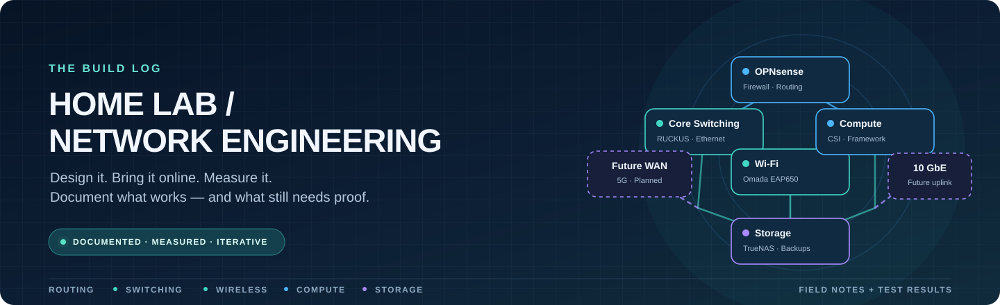

  
  
  

# Home-Lab Network Engineering

A hands-on record of building, commissioning, testing, and improving a home-lab network. The project brings together firewalling, managed switching, Wi-Fi tuning, compute, storage, and planned higher-speed connectivity.

> **Engineering rule:** If it has not been tested, it is marked as planned or in progress. Design assumptions, measured results, and unresolved issues are kept distinct.

> **Privacy note:** Private LAN addresses in public notes and command examples have been replaced with RFC 5737 documentation-only address ranges. They are anonymized examples, not live endpoints.

## Architecture at a glance

[**Read the full network plan →**](docs/home-lab-network-plan.md) · [Topology notes](docs/home-lab-network-topology-plan.md)

[**Explore the interactive Archify topology →**](https://dukeraider2.github.io/OPNsense_BACKUP/)

| Layer | Equipment / purpose | Current state |
|---|---|---|
| **WAN & routing** | Starlink → OPNsense firewall/router | Basic gateway, external connectivity, and DNS tests passed from a Windows client; final production design remains documented in the plan. |
| **Core switching** | RUCKUS ICX7150-C12P | Firmware and boot image updated and verified; several 1 GbE links tested. |
| **Wireless access** | TP-Link Omada EAP650 V1 | Radio settings adjusted; real LAN throughput test still pending. |
| **Edge Ethernet** | Dell PowerConnect X1018 | Firmware and boot code updated; switch-to-switch uplink and end-to-end path still need testing. |
| **Compute** | Six dual-NIC CSI nodes; Framework Desktop; Red Queen PC | Roles planned and documented; node interconnect and PoE requirements need validation. |
| **Storage** | TrueNAS | Shared storage role documented; endpoint link speeds and throughput remain to be measured. |

## Project status

| Status | Meaning |
|---|---|
| ✅ **Verified** | Observed on the equipment or demonstrated by a recorded test. |
| 🟡 **In progress** | Partially commissioned or awaiting a defined validation test. |
| 🔭 **Planned** | Future design or candidate hardware; not yet commissioned. |

### Latest milestones

- ✅ **RUCKUS firmware recovery and upgrade:** FastIron 08.0.95sT211 UFI and boot code 10.1.27T225 verified; primary boot checks passed. Selected ports negotiated at 1 GbE and OPNsense connectivity was tested.
- ✅ **Dell X1018 firmware upgrade:** Software 3.0.1.9 and boot code 1.0.0.25 verified after reboot. Initial management and link checks recorded; production uplink is not yet validated.
- 🟡 **EAP650 Wi-Fi tuning:** 5 GHz configured on channel 100 / 80 MHz / 20 dBm and 2.4 GHz on channel 1 / 20 MHz / 20 dBm. The Intel AX210 reported a strong signal and high PHY link rate; LAN throughput remains unmeasured.
- 🟡 **End-to-end commissioning:** Complete switch uplink checks, test the wired path, and validate PoE loads before treating the whole topology as production-ready.

## Field notes

These logs capture what was changed, the evidence observed, and what remains to be tested.

| Log | Why it matters |
|---|---|
| [EAP650 Wi-Fi tuning and throughput test](docs/blog/2026-10-18-eap650-wifi-tuning-throughput-test.md) | Channel scan, applied radio settings, link observations, and a pinned `iperf3` follow-up procedure. |
| [Dell X1018 firmware upgrade](docs/blog/2026-10-18-dell-x1018-firmware-upgrade.md) | Firmware and boot-code update, console checks, and initial link validation. |
| [RUCKUS ICX7150 firmware upgrade](docs/blog/2026-10-17-icx7150-firmware-upgrade.md) | Firmware recovery, boot partition verification, and initial PoE/LAN commissioning. |

## Explore the documentation

<table>
  <tr>
    <td width="50%">
      <h3>🧭 Network design</h3>
      
Topology, intended device roles, traffic paths, segmentation concepts, and rollout phases.

      <a href="docs/home-lab-network-plan.md">Professional network plan</a> 
      <a href="docs/starlink-network-integration.md">Starlink WAN integration and validation plan</a> 
      <a href="docs/home-lab-network-topology-plan.md">Topology implementation notes</a>
    </td>
    <td width="50%">
      <h3>🧰 Equipment reference</h3>
      
Hardware roles, support links, manuals, firmware references, and verification points.

      <a href="docs/equipment-profiles.md">Equipment profiles</a> 
      <a href="docs/remote-kvm-fleet.md">Four-unit GL.iNet remote KVM fleet</a> 
      <a href="docs/equipment-manuals.md">Official manuals and documentation</a> 
      <a href="docs/ruckus-icx7150-c12p-internal-hardware-research.md">RUCKUS internal hardware / PCIe expansion research</a>
    </td>
  </tr>
  <tr>
    <td width="50%">
      <h3>🧪 Test evidence</h3>
      
Upgrade results, CLI commands, observed status, and reproducible validation steps.

      <a href="attachments/icx7150-upgrade-evidence.md">RUCKUS evidence</a> 
      <a href="attachments/dell-x1018-upgrade-evidence.md">Dell X1018 evidence</a> 
      <a href="examples/dell-x1018/commands-used.md">Dell commands used</a>
    </td>
    <td width="50%">
      <h3>🔭 Future improvements</h3>
      
Potential upgrades are tracked separately from installed and tested infrastructure.

      <a href="docs/future-5g-wan-shortlist.md">5G WAN shortlist: four-unit U5G fleet vs. MUDI 7</a> 
      <a href="docs/future-5g-wan-candidate-unifi-u5g-eu.md">UniFi 5G Backup U5G-EU fleet candidate</a> 
      <a href="docs/future-5g-wan-candidate-mudi-7-gl-e5800eu.md">Portable 5G WAN candidate: MUDI 7 EU</a> 
      <a href="docs/home-lab-network-plan.md#7-storage-and-future-high-speed-expansion">2.5 GbE access / 10 GbE uplink plan</a> <a href="docs/future-truenas-usb-2.5gbe-adapter-shortlist.md">TrueNAS USB 2.5GbE adapter shortlist</a>
    </td>
  </tr>
</table>

## Engineering methods and field documentation

Use these documents to reproduce tests, trace physical connectivity, and review troubleshooting decisions:

- [Network testing and validation standard](docs/testing-and-validation-standard.md) — test objectives, procedures, pass/fail criteria, performance measurements, and evidence handling.
- [Physical network port map](docs/physical-port-map.md) — working connection register and commissioning checklist; TBD fields remain unverified until observed.
- [Troubleshooting case-study template](docs/templates/troubleshooting-case-study.md) — reusable format for documenting symptoms, hypotheses, diagnostic evidence, corrective action, and verification.

## Roadmap

- [ ] Validate the Dell-to-RUCKUS uplink and end-to-end client traffic.
- [ ] Complete the EAP650 wired-host `iperf3` test in both directions.
- [ ] Verify the RUCKUS PoE budget and CSI splitter compatibility before powering all planned nodes.
- [ ] Finalize VLAN IDs, trunk membership, OPNsense interfaces, DHCP scopes, and firewall rules before enabling segmentation.
- [ ] Measure TrueNAS and compute endpoint link speeds and real transfer performance.
- [ ] Review the TrueNAS USB 2.5GbE adapter shortlist; verify TrueNAS edition/version and driver support before purchasing.
- [ ] Compare future 2.5 GbE / 10 GbE expansion and mobile 5G WAN options against the actual requirements.

## How this repository is maintained

- **Manufacturer first:** prefer vendor manuals and firmware pages for version-specific instructions.
- **Evidence over assumption:** record commands, versions, observed outputs, and test limits.
- **Safe changes:** back up configurations before changes where possible, and document when no backup was taken.
- **No secrets in Git:** do not commit passwords, tokens, private keys, or unredacted configuration exports.
- **Clear status:** mark hardware and network features as planned until they are physically connected and validated.

---

  Built hands-on, documented as it evolves. The goal is a reliable, understandable network—not a diagram that merely looks finished.

