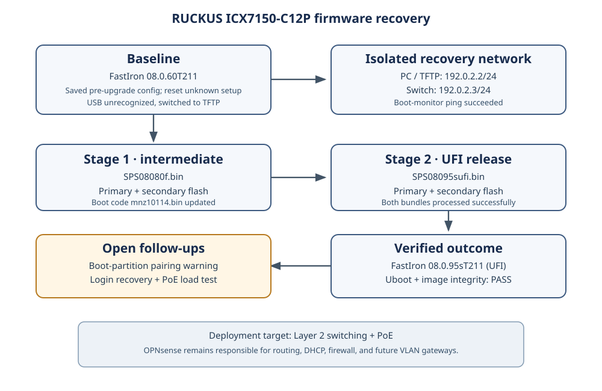

# Field note: Recovering and commissioning a RUCKUS ICX7150-C12P

This field note records recovery, firmware upgrade, boot-partition synchronization, and initial commissioning of a used RUCKUS ICX7150-C12P for a home lab. The intended role is Layer 2 switching with PoE. The Riverbed SteelHead CX-770 running OPNsense remains responsible for routing, firewall policy, DHCP, DNS service, and future VLAN gateways.

This is a lab record, not a substitute for release-specific RUCKUS procedures. Firmware binaries are deliberately not committed here; download them from RUCKUS for the exact hardware and supported release path.

## Final verified state

- FastIron: **08.0.95sT211 (UFI)**.
- Both flash image entries: **08.0.95sT211**.
- Both boot-code entries: **10.1.27T225 (mnz10127)**.
- The switch was explicitly rebooted from Primary after synchronization; the console showed it booted from partition 1 and the Uboot and image checksum tests passed.
- Ports **1/1/1, 1/1/2, and 1/1/3** were all reported **Up / Forward**, full duplex at 1 Gbps.
- OPNsense gateway, internet-IP reachability, and DNS tests passed from the Windows client.
- PoE on port **1/1/3** was On and delivering power to a connected IEEE Class 4 endpoint.

The switch is functioning for this lab's basic LAN use. One PoE controller reset warning appeared during the Primary reboot; because PoE initialized and subsequently delivered power, the warning is recorded for observation rather than described as an ongoing failure. Further post-boot log output was not captured in this session.

## Starting condition

The switch booted on FastIron 08.0.60T211, but its previous-owner configuration was unknown. A small pre-upgrade running configuration was saved locally before the startup configuration was cleared.

The USB update path was abandoned after the switch reported that an external USB device was not present. That showed the switch did not recognize the device at that time; it did not prove the USB drive itself was defective. The transfer method was changed to TFTP.

## Isolated TFTP path

A dedicated PC Ethernet adapter named 1gb Network (Realtek Gaming GbE) was assigned 192.0.2.2/24. Tftpd32 served a dedicated firmware folder on that adapter. In the switch boot monitor, the switch address was 192.0.2.3/24, with the TFTP server set to 192.0.2.2.

The boot-monitor ping returned a successful reply from 192.0.2.2. Keeping the recovery link isolated avoided modifying the PC's other LAN adapter.

## Upgrade stages and observed result

### Stage 1: FastIron 08.0.60T211 to 08.0.80f

The ICX7150-specific documented path used an intermediate 08.0.80f image before moving to UFI. The following files were served from TFTP:

- mnz10114.bin: paired bootloader update
- SPS08080f.bin: intermediate FastIron image

The boot monitor transferred the intermediate image to both primary and secondary partitions. Console output showed TFTP to Flash Done, OK for NAND writes, and 26,214,400 bytes written for both switch-image partitions. The bootloader update also completed.

After reboot, show version reported FastIron 08.0.80fT211 and boot monitor 10.1.14T225 (mnz10114).

### Stage 2: FastIron 08.0.80f to 08.0.95s UFI

The selected lab target was the ICX7150 08.0.95s UFI release shown on the RUCKUS product/software page at the time of the upgrade.

The switch CLI copied SPS08095sufi.bin to primary and then secondary flash. Both transfers ended with Bundle image processed successfully. After reboot, the switch passed both Uboot and image checksum integrity tests, and show version reported FastIron 08.0.95sT211.

### Stage 3: Synchronize boot partitions and verify Primary boot

The first UFI boot logged that Uboot and FastIron came from different partitions and that the other Uboot partition did not have the recommended version. The observed flash inventory showed:

- Primary image: 08.0.95sT211; primary boot code: 10.1.14T225
- Secondary image: 08.0.95sT211; secondary boot code: 10.1.27T225

The switch was then booted from Secondary and reached the normal CLI. The console boot log showed Uboot checksum verification PASS and image checksum verification PASS. The following command synchronized the running bundle to Primary:

~~~text
copy flash flash primary
~~~

The command completed with Bundle image processed successfully and Copy Done. The subsequent show flash output reported both image entries at 08.0.95sT211 and both boot-code entries at 10.1.27T225 (mnz10127).

The switch was then explicitly rebooted from Primary:

~~~text
boot system flash primary yes
~~~

The boot console reported Booted from partition 1, then Uboot checksum verification PASS and image checksum verification PASS. After login, show version identified SPS08095s.bin (UFI) from Primary, and show flash still reported matched image and boot-code versions. The previously observed cross-partition mismatch was therefore corrected in the captured flash inventory and a successful Primary boot was verified.

## Post-upgrade network validation

The lab topology used these active data ports:

| Switch port | Observed role | Post-boot result |
| --- | --- | --- |
| 1/1/1 | OPNsense LAN uplink | Up / Forward, full duplex, 1 Gbps |
| 1/1/2 | Windows test client | Up / Forward, full duplex, 1 Gbps |
| 1/1/3 | PoE endpoint | Up / Forward, full duplex, 1 Gbps |

The Windows adapter 1gb Network received a DHCP lease with:

- Client IPv4 address: 198.51.100.124
- Subnet mask: 255.255.255.0
- Default gateway: 198.51.100.1
- DHCP server: 198.51.100.1
- DNS server: 198.51.100.1

The PC was tested with its source address explicitly bound to 198.51.100.124:

- Ping to OPNsense at 198.51.100.1: 4 sent, 4 received, 0% loss.
- Ping to 1.1.1.1: 4 sent, 4 received, 0% loss; measured average round-trip time was 40 ms in this test.
- Resolve-DnsName for example.com using DNS server 198.51.100.1 returned A and AAAA records.

This verifies the tested client path through the switch and OPNsense for local gateway reachability, outbound IP connectivity, and DNS resolution.

A temporary management address of 192.0.2.3/24 had also been configured and ping-verified during recovery. In the final post-Primary show interfaces brief output, mgmt1 was Down; a dedicated out-of-band management link was not connected at that moment. Do not assume the recovery-stage address is reachable through an unused physical management port.

## PoE validation and caution

The switch reported a 124 W total PoE capacity. After the Primary boot, show inline power reported port 1/1/3:

- Admin state: On
- Oper state: On
- Power consumed: 6,100 mW (6.1 W)
- Power allocated: 30,000 mW (30 W)
- PD type: 2P-IEEE
- PD class: Class 4
- Remaining PoE budget reported: 94,000 mW (94 W)

This verifies power delivery to the endpoint connected to port 1/1/3 after the Primary boot.

The Primary boot log also printed: PoE Severe Error: Unexpected controller reset encountered on PoE module. Later in the same boot, PoE module initialization completed and the log stated that power was enabled on port 1/1/3. The subsequent live PoE reading showed the endpoint powered at 6.1 W. Because a post-boot show logging capture was not saved, this note does not claim the event is absent from the logs or fully diagnosed. Monitor the controller and endpoint during normal use; collect show logging and show inline power detail if the warning recurs or power becomes unstable.

During the earlier first startup on 08.0.95s, the PoE controller also reported firmware download progress to 100%, programming/upgrading completed, a module reset/restart, default programming completed, and PoE module initialization finished.

## Operating scope and remaining observations

- The initial target remains Layer 2 switching with PoE. OPNsense is the routing, firewall, and DHCP authority. User VLAN segmentation was not implemented in this session.
- Basic client networking and PoE passed the observed tests. This is commissioning evidence for this lab configuration, not a guarantee against future faults or a replacement for routine monitoring.
- The mgmt1 physical link was Down in the final port-status capture. If out-of-band management is required, connect and validate that dedicated interface; otherwise arrange the intended production management path explicitly.
- The observed PoE controller reset warning should be monitored and investigated if it recurs, despite the currently successful power reading.
- Passwords and other credentials are intentionally omitted from this repository. Firmware binaries are also excluded; obtain them from official RUCKUS sources.

## Lessons worth keeping

- Preserve a baseline before changing an unknown switch configuration.
- Isolate the TFTP path on a dedicated PC adapter; do not alter unrelated network adapters.
- Match commands and expected output to the exact FastIron release. Avoid automation that depends on a guessed success string.
- After every firmware operation, verify versions and integrity output from the switch itself. A script timeout is not the same as a failed upgrade, and a script success banner is not proof without real device output.
- After a partition synchronization, check show flash and verify an actual boot from the intended partition.
- Check real link, DHCP, routing, DNS, and PoE behavior after firmware work. Module initialization alone is not equivalent to a powered endpoint test.
- Keep vendor firmware binaries out of the repository; retain commands, observations, and evidence summaries instead.

## Official references

- [RUCKUS ICX7150 product and software page](https://support.ruckuswireless.com/products/108-ruckus-icx-7150-campus-switches)
- [RUCKUS ICX7150 upgrade article](https://support.ruckuswireless.com/articles/000015158)
- [FastIron 08.0.60 software upgrade guide](https://support.ruckuswireless.com/documents/1402-fastiron-08-0-60-software-upgrade-guide)
- [FastIron 08.0.60 command reference](https://support.ruckuswireless.com/documents/1417-fastiron-08-0-60-command-reference-guide)

## Supporting files

- [TFTP preflight script](../../examples/ruckus-icx7150/tftp-preflight.ps1)
- [Recorded commands and scope notes](../../examples/ruckus-icx7150/commands-used.md)
- [Upgrade and commissioning evidence summary](../../attachments/icx7150-upgrade-evidence.md)
- [Sanitized console excerpts](../../attachments/icx7150-console-excerpts.txt)
